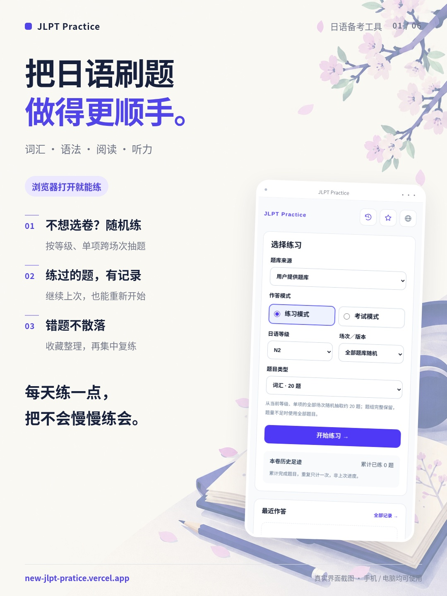
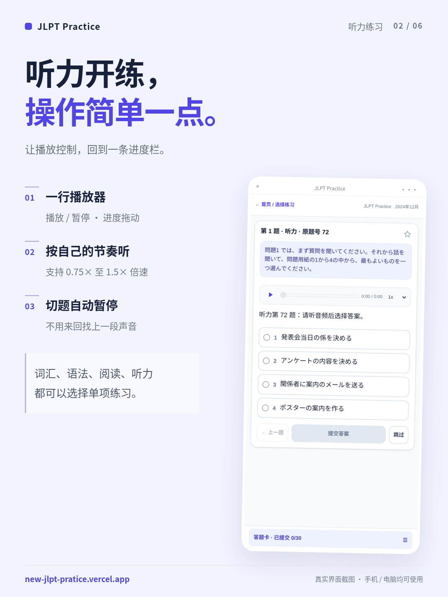
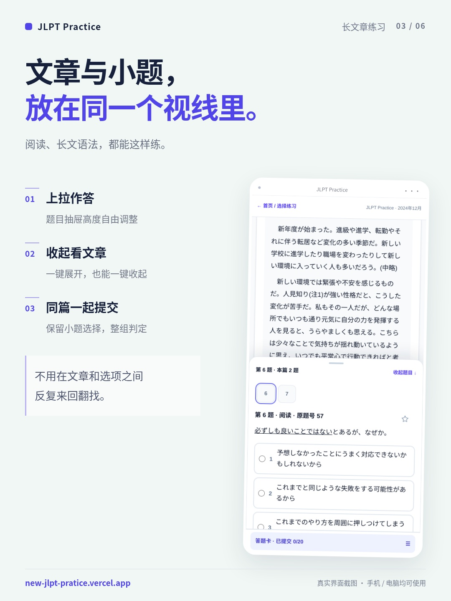
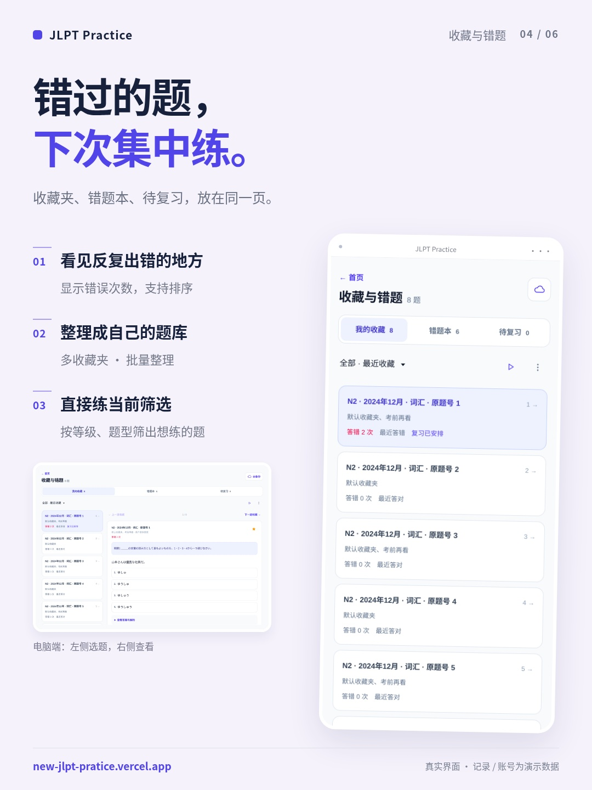
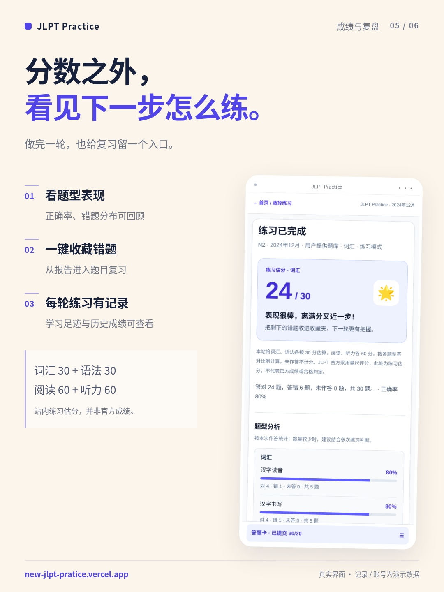
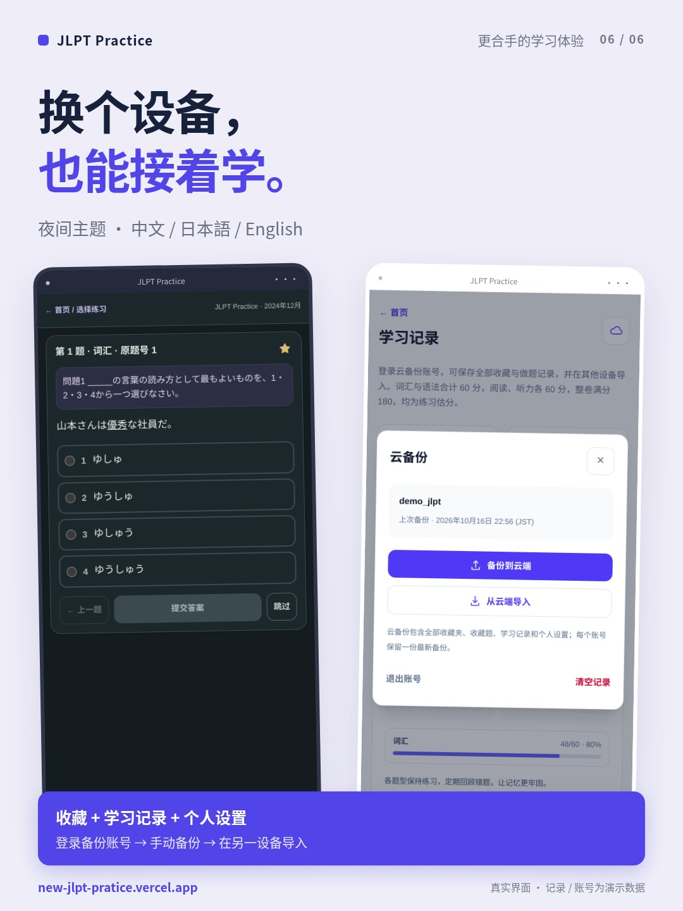

# JLPT Practice 小红书宣传资料

[下载完整资料包（9 MB）](https://github.com/Linkyyy/new-jlpt-pratice/raw/refs/heads/xhs-materials-20261016/jlpt-xhs-2026-10-16.zip)

[下载 JPG 轻量包（1.1 MB）](https://github.com/Linkyyy/new-jlpt-pratice/raw/refs/heads/xhs-materials-20261016/jlpt-xhs-2026-10-16-jpg.zip)

[打开发布文案](./caption.txt)

完整包包含六张 1080×1440 宣传图（PNG / JPG）、十二张截图、发布文案、PDF 和排版源文件。

手机可以直接点击下列图片查看，长按保存。按 01 → 06 顺序发布。

界面截图来自版本 59acf39，成绩、收藏与云备份账号为演示数据。
