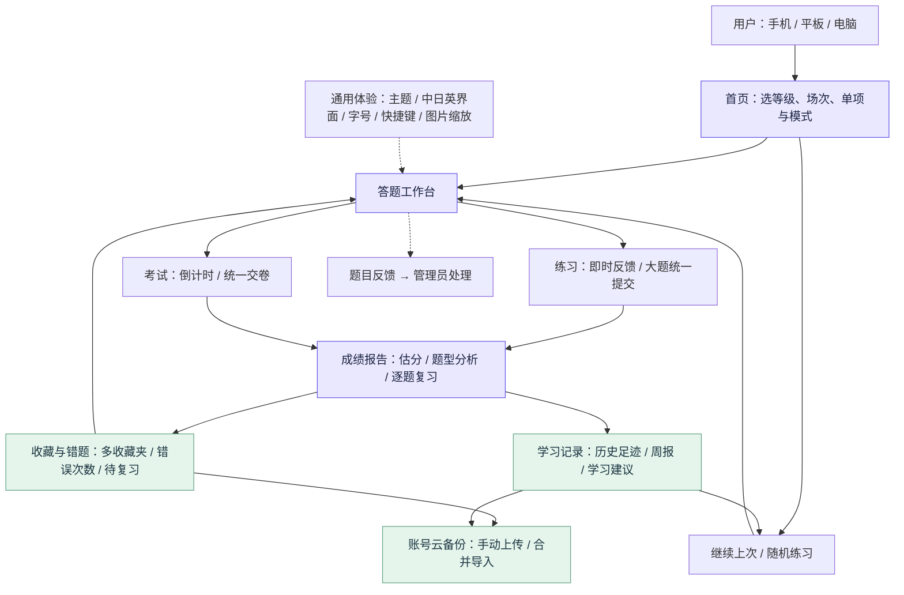
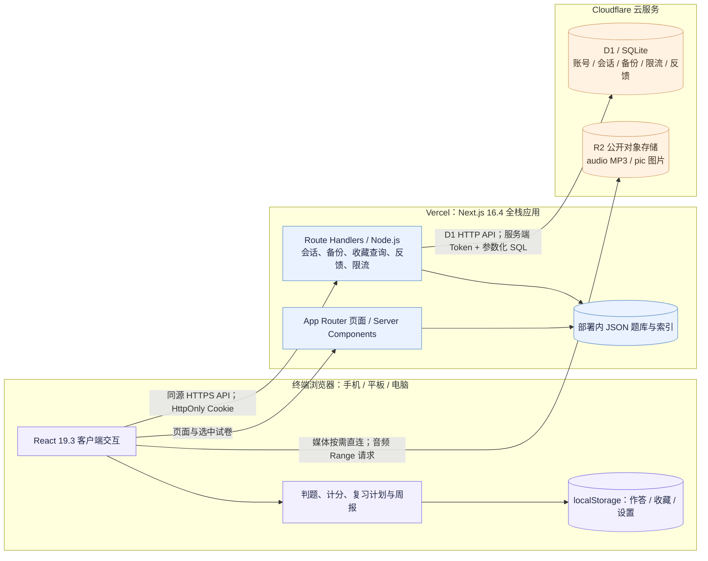
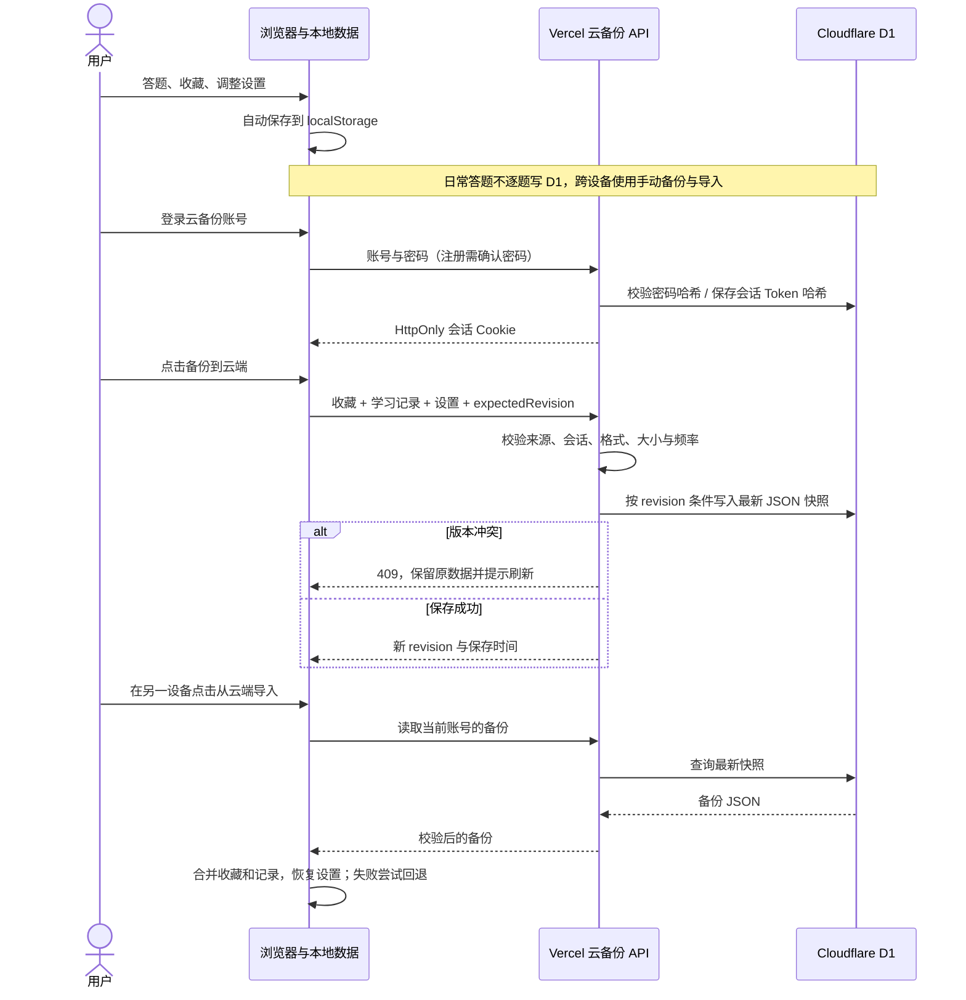
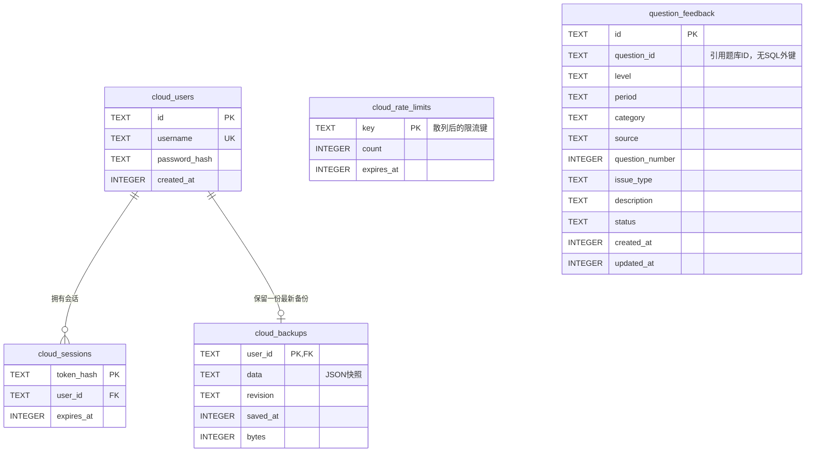
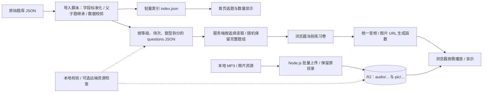

# JLPT Practice 网站架构说明

基于仓库 `Linkyyy/new-jlpt-pratice` 的代码版本 **59acf39** 整理，日期 **2026-10-17**。此文描述当前代码实现；云平台规则是否实际启用仍以 Vercel、Cloudflare 控制台为准。

资料下载：[完整说明与图件 ZIP](https://raw.githubusercontent.com/Linkyyy/new-jlpt-pratice/architecture-20261017/jlpt-architecture-2026-10-17.zip) · [5 页架构图 PDF](./architecture.pdf) · [业务架构 PNG](./business.png) · [技术架构 PNG](./technical.png)。`diagrams/` 目录提供 5 张高清 PNG、可放大 SVG 和 Mermaid 源码。

## 1. 整体定位

这是一个采用 **Next.js 全栈单体 + 浏览器本地数据 + Cloudflare 托管存储** 的响应式日语刷题网站。

- 页面和 API 在同一个 Next.js 项目中，由 Vercel 部署，无需单独维护一套 Express 后端。
- 答题、收藏、个人设置首先保存在浏览器；注册登录主要用于云备份和管理员身份，普通刷题不要求登录。
- 题库正文是版本化 JSON 文件，跟随部署；MP3 和图片以独立对象保存到 R2，由浏览器直接读取。
- D1 保存账号、会话、每个账号的一份最新备份、限流计数和题目反馈，不逐题写入作答数据。

## 2. 业务功能架构

| 功能域 | 已有功能 | 页面入口 |
|---|---|---|
| 首页 | 题库来源、等级、场次、模式、继续上次、重新开始、历史足迹、复习建议 | `/` |
| 练习与考试 | 四大题型、完整试卷、单项随机、统一题组提交、倒计时、答题卡、设置、快捷键 | `/practice` |
| 收藏与错题 | 一题多收藏夹、批量整理、筛选排序、错误次数、待复习、收藏/错题复练 | `/favorites`、`/favorites/practice` |
| 学习记录 | 每轮成绩、作答快照、继续/复习、累计统计、学习周报 | `/history`、`/history/[id]` |
| 反馈管理 | 答题设置中提交问题；管理员筛选和修改处理状态 | `/feedback` |
| 通用体验 | 中文/日语/英语、日间/夜间/跟随系统、字号滑块、图片全屏缩放拖动、加载与消息提示 | 跨页面组件 |

## 3. 技术部署架构

| 层次 | 当前技术 | 职责 |
|---|---|---|
| 前端与页面 | Next.js 16.4.0、React 19.3.0、TypeScript 严格模式 | App Router、服务端页面与客户端交互 |
| 样式 | Tailwind CSS 4、自定义 CSS、CSS 主题变量 | 响应式布局、抽屉、浮窗、夜间主题 |
| 本地状态 | React Hooks、`useSyncExternalStore`、localStorage | 答题保存、收藏、设置及跨标签页更新 |
| 后端 | Next.js Route Handlers、Node.js 内置能力 | 账号认证、云备份、题目查询与反馈 |
| 题库数据 | JSON 题库 + 轻量索引 + Node fs | 按需读取试卷，按真实题目 ID 关联收藏与媒体 |
| 云数据库 | Cloudflare D1（SQLite） | 服务端通过 Cloudflare HTTP API 访问 |
| 对象存储 | Cloudflare R2 | MP3 与配图，公开 URL 直连、按需加载 |
| 工具链 | Node.js、npm、Turbopack、ESLint、Node Test Runner | 本地开发、导入、验证、构建和测试 |
| 发布 | GitHub + Vercel Next.js 部署 | 构建并部署页面、静态资源和服务端函数 |

配置已启用 Next.js `cacheComponents` 和 `partialPrefetching`。这不意味着所有动态请求都被持久缓存；例如 D1 请求明确使用 `no-store`。题库读取使用 React `cache` 进行调用复用，JSON 文件通过 `outputFileTracingIncludes` 随服务端部署。

## 4. 数据保存方式与备份

### 浏览器数据

| localStorage 键 | 内容 |
|---|---|
| `jlpt-practice.study.v1` | 作答轮次、题目 ID/答案/选项等快照、选择与提交状态、当前题、考试截止时间、学习日期 |
| `jlpt-practice.favorites.v1` | 收藏夹、题目 ID、多收藏夹归属及收藏时间；当前数据结构为 version 2，键名保留 v1 |
| `jlpt-practice.preferences.v1` | 首页选择、切题开关、字号、倍速、收藏模式及排序 |
| `jlpt-practice.display.v1` | 主题与界面语言 |

历史记录保存用于判题与恢复的题目元数据快照，不是把完整题库正文和音频复制到 localStorage。恢复时会与当前题库核对；题目或答案变更时避免直接用新题覆盖旧记录。错题次数、复习建议、周报主要从已提交记录推导，无独立的云端错题明细表。

### 云备份流程

- 每个账号只保留一份最新备份，JSON 包含收藏、学习记录、个人设置、主题和语言；上限为 **1 MiB**。
- 使用 `revision` 做乐观并发控制，避免另一设备的新备份被直接覆盖。
- 导入合并收藏和学习记录，恢复备份中的设置；旧备份缺少设置字段时保留本机设置。多键写入失败会尝试恢复此前数据。
- 清空记录只能确认后清空全部，不支持单条删除；保留收藏、设置，已登录时也清理对应云备份中的学习记录。
- 云备份是手动触发；切换设置或日常答题不会逐题自动上传。跨设备不是实时同步。

### D1 数据库关系

`question_feedback` 通过题目 ID 逻辑关联部署中的 JSON，没有指向题库表或用户表的外键。`cloud_rate_limits` 是独立计数表。D1 不保存 MP3 / JPG，也不使用逐题作答 SQL 表。

## 5. 题库与音频图片流程

- 原创题库：`src/data/question-bank.json`，支持 N1–N5，共 90 道精简模拟题。
- 用户题库：`src/data/imported-bank/index.json` 与 `questions/*.json`。当前索引有 **347 个分组文件、8608 道可作答题、61 道暂不可用题**，覆盖 N1–N3，场次范围 2010 年 7 月至 2024 年 12 月；不同等级与场次的实际覆盖以索引为准。
- 音频路径例：`audio/202412n2/1.mp3`；图片路径例：`pic/220241270.jpg`。`audio` 和 `pic` 在 R2 根目录同级。
- `audio-url.mjs` / `image-url.mjs` 统一拼接资源域名。更换 `NEXT_PUBLIC_AUDIO_BASE_URL` 后重新构建即可切换域名；原对象路径不变。
- 同篇文章或同一音频的小题按完整题组组织；随机单项目标约 20 题，最后一组可能使数量超过 20。随机种子写入 URL 和作答记录，保证刷新与续做不重新洗题。
- `@aws-sdk/client-s3` 用于本地批量上传工具，不是让 Vercel 中转媒体。`.vercelignore` 和构建前检查防止将 MP3 打包进部署。
- 可作答数量是题库索引的结果，不表示远端每一个 MP3/JPG 都已上传或通过在线检查。远端缺资源时在当前题目提示失败、允许重试。

## 6. 后端接口

| 接口 | 方法 | 用途 |
|---|---|---|
| `/api/favorites/questions` | POST | 批量按 ID 查询收藏/错题正文；逻辑只读 |
| `/api/practice/favorites` | POST | 读取收藏/错题练习用题目；逻辑只读 |
| `/api/cloud-backup/auth` | GET / POST | 查询登录状态、注册、登录、退出 |
| `/api/cloud-backup` | GET / POST | 读取 / 保存账号的最新备份 |
| `/api/cloud-backup/history` | DELETE | 确认后清空账号云备份中的全部学习记录 |
| `/api/feedback` | POST / GET / PATCH | 提交反馈 / 管理员查询 / 更新处理状态 |
| `/api/activation` | POST | 共享暗号验证；当前开关关闭 |

## 7. 安全、运行边界与后续扩展位置

- 密码采用带随机盐的 scrypt 哈希；服务端只保存会话 Token 的 SHA-256 哈希，浏览器持有 HttpOnly Cookie，会话有效期 30 天；HTTPS 下设置 Secure。
- 服务端写请求检查来源，执行格式与实际字节数限制；查询使用参数化 SQL。题库富文本经标签白名单转成 React 元素，不直接注入来源 HTML。
- API 使用实例内 IP / 会话突发限流，部分账号、登录、反馈操作还有 D1 持久限流。实例内计数不等于跨实例的全站硬额度。
- R2 当前采用公开资源直连，网站 API 限流不能拦住直接请求媒体的流量。自定义域名、WAF 或鉴权 Worker 是可扩展位置，不是当前代码已部署的组成部分。
- 反馈管理员复用云备份账号，以 `FEEDBACK_ADMIN_USERS` 允许名单授权。暗号开关 `PASSPHRASE_REQUIRED=false`，目前不是强制答题门槛。
- 未在应用中发现 `@vercel/analytics` 接入，不能把 Web Analytics 视为当前已实现组件；平台控制台设置另行核实。
- 分数在浏览器由同一计分模块计算，词汇 30、语法 30、阅读 60、听力 60。属于学习估分；当前不是服务端防作弊的正式考试系统。

## 8. 代码导航

| 位置 | 主要责任 |
|---|---|
| `src/app/` | 页面、答题与考试工作台、收藏、历史、反馈和 API 路由 |
| `src/components/` | 播放器、图片查看器、收藏按钮、云备份弹窗、报告、周报、通用交互 |
| `src/lib/study-store.ts` | 本地作答保存、历史、足迹、合并 |
| `src/lib/favorites-store.ts` | 多收藏夹、收藏批量整理与合并 |
| `src/lib/study-insights.ts` | 错误次数、间隔复习与周报等学习推导 |
| `src/lib/practice-scoring.ts` | 统一练习估分 |
| `src/lib/learning-backup.ts` | 备份快照、合并、设置恢复与回退 |
| `src/lib/cloud-backup.server.ts` | D1 HTTP 查询、密码与会话、备份版本控制、持久限流 |
| `src/lib/question-feedback.server.ts` | 题目反馈与管理员授权 |
| `src/data/imported-papers.server.ts` | 按选中题型读取 JSON 与收藏题查询 |
| `src/data/random-practice.ts` | 固定种子的题组随机抽取 |
| `scripts/` | 题库导入、资源检查、R2 上传、D1 初始化与自动化测试 |
| `migrations/` | D1 用户/会话/备份/限流表与反馈表迁移 |
| `docs/` | 云备份、R2、题库反馈及请求限制配置说明 |

服务端环境变量包括 `CLOUDFLARE_ACCOUNT_ID`、`CLOUDFLARE_D1_DATABASE_ID`、`CLOUDFLARE_D1_API_TOKEN`；媒体域名用公开的 `NEXT_PUBLIC_AUDIO_BASE_URL`。本说明不包含任何变量值或凭据。
