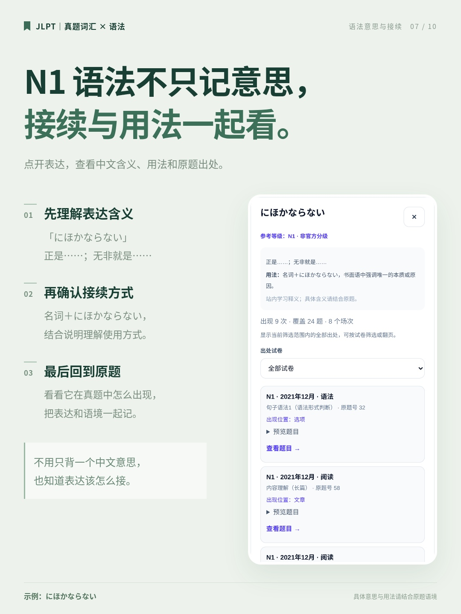
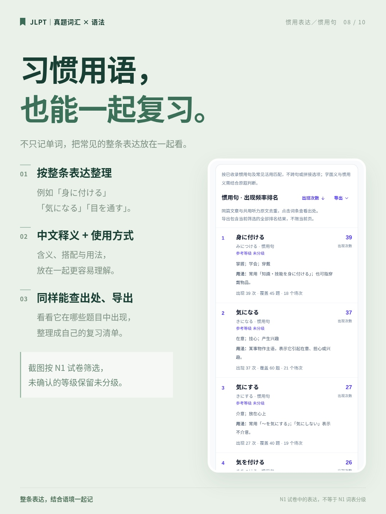
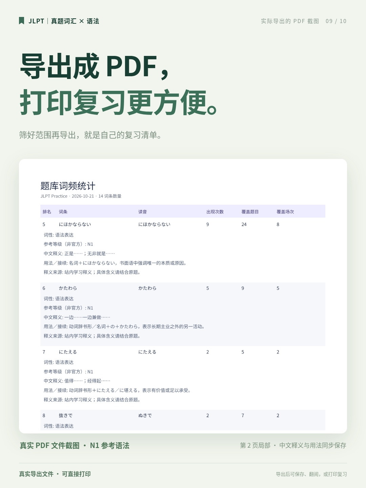

# N1 参考词汇／语法检索 · 全新 10 张宣传图

2026-10-21 新版。**10 张 1080×1440 竖图，无网址、无二维码**，浅绿简洁风格，使用当前网站的真实界面和实际导出的 PDF 页面。

- **[下载手机发布包：10 张 JPG＋文案](jlpt-n1-xhs-jpg.zip)**
- **[下载完整资料包：JPG、PNG、宣传图 PDF、截图、排版源文件、文案](jlpt-n1-xhs-full.zip)**
- [查看宣传文案（完整＋简短）](copy.md)
- [下载 TXT 文案](copy.txt)
- [下载 10 页宣传图 PDF](posters.pdf)

## 全套预览

## 单张查看与保存

手机可以点开 JPG 后长按保存。发布推荐使用 JPG，PNG 适合留存原图。

### 01 · 自己开发的真题词汇语法检索站

[查看／保存 JPG](posters/01.jpg) · [下载 PNG](posters/01.png)

### 02 · N1参考词汇清单

[查看／保存 JPG](posters/02.jpg) · [下载 PNG](posters/02.png)

### 03 · 多条件组合筛选

[查看／保存 JPG](posters/03.jpg) · [下载 PNG](posters/03.png)

### 04 · 频次与覆盖范围排序

[查看／保存 JPG](posters/04.jpg) · [下载 PNG](posters/04.png)

### 05 · 点击N1词汇后的详情

[查看／保存 JPG](posters/05.jpg) · [下载 PNG](posters/05.png)

### 06 · N1参考语法清单

[查看／保存 JPG](posters/06.jpg) · [下载 PNG](posters/06.png)

### 07 · N1语法的意思接续与出处

[查看／保存 JPG](posters/07.jpg) · [下载 PNG](posters/07.png)

### 08 · 惯用表达与习惯用语

[查看／保存 JPG](posters/08.jpg) · [下载 PNG](posters/08.png)

### 09 · 网站实际导出的PDF截图

[查看／保存 JPG](posters/09.jpg) · [下载 PNG](posters/09.png)

### 10 · 手机查词电脑整理

[查看／保存 JPG](posters/10.jpg) · [下载 PNG](posters/10.png)

## 本套截图范围

- **词汇与语法**：实际选择“试卷等级 N1＋词条参考等级 N1”。参考等级是公开学习资料的非官方分类。
- **点击词汇后的详情**：展示「認識」等 N1 参考词汇的中文意思、年月场次、题型、原题号及查看原题入口。
- **惯用句／习惯用语**：实际按 N1 试卷筛选；没有可确认的词条等级仍显示“未分级”。不把所有 N1 试卷中的表达标为 N1 参考词汇。
- **PDF 截图**：第 09 张使用网站实际导出的 N1 参考语法 PDF 第 2 页局部。对应原始截图为 [14-n1-grammar-pdf-page2.png](screenshots/14-n1-grammar-pdf-page2.png)，内容未改写。本目录 `posters.pdf` 为 10 张宣传图合集。

截图来自网站代码提交 `b605832` 的本地生产构建；题文出现频次不等于实际考点频率。截图条件与素材说明见 [source/capture-notes.json](source/capture-notes.json)。

建议按 01–10 的顺序发布，01 做封面；如需减少张数，可从 02、03、04 中择取。排版源文件为 [source/posters.html](source/posters.html)，素材分支独立保存，不改动网站主分支。
