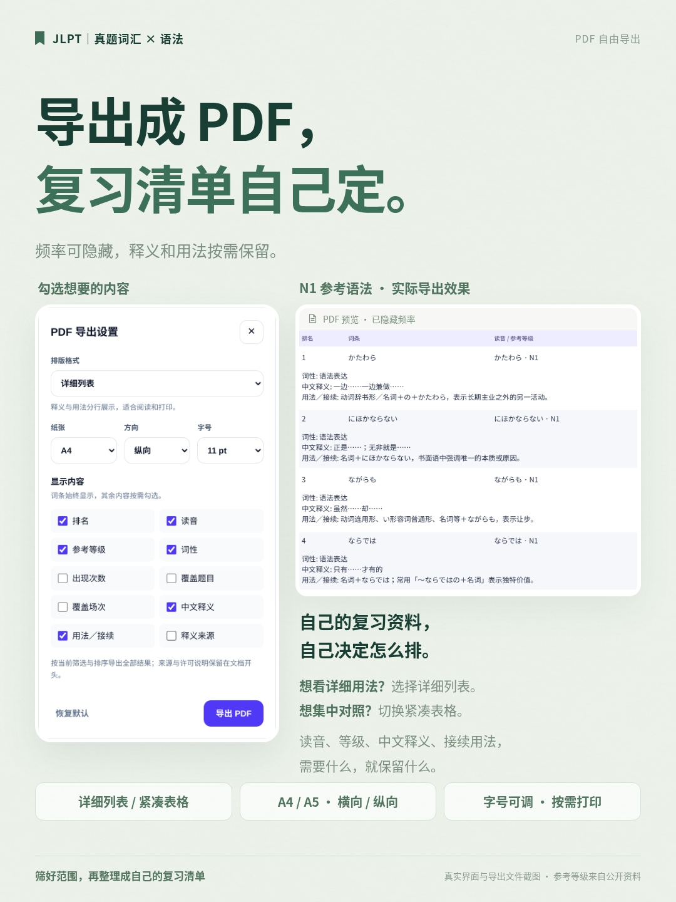

# JLPT · PDF 自由导出宣传图

可替换上一套宣传图中介绍 PDF 的那张。1080 × 1440，浅绿风格，不带网址、不带宣传图编号。

- [查看／保存 JPG](jlpt-pdf-export.jpg)
- [下载高清 PNG](jlpt-pdf-export.png)
- [下载单页宣传 PDF](jlpt-pdf-export.pdf)
- [下载完整资料包](jlpt-pdf-promo.zip)

截图来自代码 `d888d5f` 的实际网站与对应 PDF 导出文件。展示 N1 试卷、N1 参考语法，选中 11 pt、详细列表、A4 纵向；取消出现次数、覆盖题目、覆盖场次与逐条释义来源。读音、参考等级、释义与接续用法保留。右侧为导出文件表格局部，未改写任何词条内容。

文案：**PDF 也能按需定制啦📄 频率可隐藏，释义和接续自由选；详细列表、紧凑表格、横竖版和字号都能调整，筛好就导出，整理成自己的复习清单。**

词条参考等级来自公开学习资料，非官方分级；文档来源与许可保留在实际导出文件开头。截图条件见 `source/capture-notes.json`。
